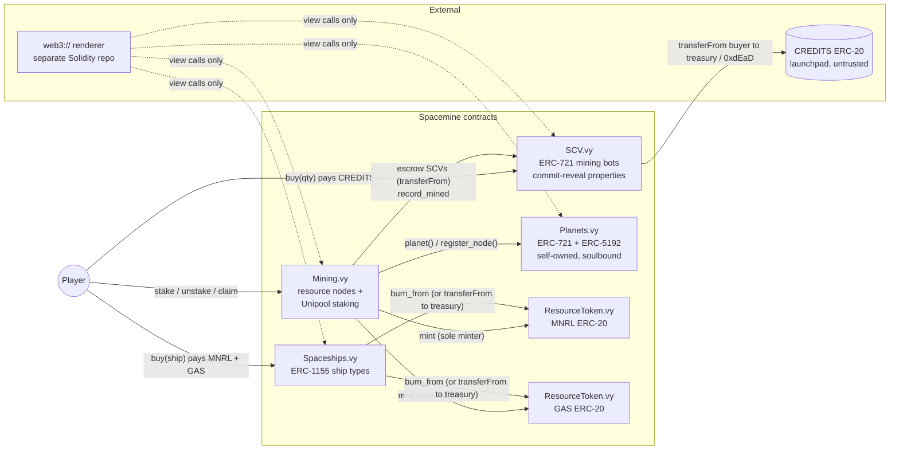

# Spacemine

On-chain mining game contracts in **Vyper 0.4.3**, built on [snekmate](https://github.com/pcaversaccio/snekmate)
0.1.2 modules and the [Moccasin](https://github.com/Cyfrin/moccasin) framework.

Players buy **SCV** mining bots with **CREDITS** (a third-party launchpad ERC-20), stake them into
**resource nodes** on **planets**, mine **MNRL** (minerals) and **GAS**, and spend those resources on
**spaceships**. All NFT metadata is served by an external `web3://` renderer
([renderer interface](docs/RENDERER_INTERFACE.md)).

## Architecture



| Contract | Standard | snekmate modules | Purpose |
|---|---|---|---|
| `src/SCV.vy` | ERC-721, Enumerable, Metadata, ERC-4494, ERC-4906, ERC-2981, ERC-5267, ERC-7572 | `erc721`, `erc2981`, `ownable`, `ownable_2step`, `block_hash` | Mining bots. Sold for CREDITS; properties assigned by commit-reveal. |
| `src/Planets.vy` | ERC-721, Enumerable, Metadata, ERC-4906, ERC-5192, ERC-7572 | `erc721`, `ownable`, `ownable_2step` | Worlds minted to the contract itself; never transferable. Registry of nodes. |
| `src/ResourceToken.vy` | ERC-20, EIP-2612, ERC-5267 | `erc20`, `ownable`, `ownable_2step` | Deployed twice: `Spacemine Minerals`/`MNRL` and `Spacemine Gas`/`GAS`. |
| `src/Mining.vy` | — | `ownable`, `ownable_2step`, `pausable` | All resource nodes, plus per-SCV Unipool accounting. |
| `src/Spaceships.vy` | ERC-1155, Metadata URI, ERC-2981, ERC-7572 | `erc1155`, `erc2981`, `ownable`, `ownable_2step` | Ship types bought with MNRL/GAS (the resource sink). |
| `src/modules/metadata.vy` | ERC-7572 | — | Shared `metadata_base`/`metadata_suffix`/`contractURI` storage. |
| `src/interfaces/*.vyi` | — | — | Project-only interfaces (`ISCV`, `IPlanets`, `IMining`, `IResourceToken`) and the shared structs. |

Standard ERC calls use Vyper's built-in `ethereum.ercs` interfaces (`IERC20`, `IERC721`, `IERC165`)
or snekmate's (`IERC1155`, `IERC721Receiver`, `IERC4906`, and so on).

### Player flow

1. `credits.approve(scv, cost)`, then `scv.buy(quantity, max_total_cost)`. SCVs are minted unrevealed
   and commit to block `block.number + 2`.
2. After the commit block, anyone calls `scv.reveal([ids])`.
3. `scv.setApprovalForAll(mining, true)`, then `mining.stake(node_id, [ids])`.
4. Wait, then `mining.claim([ids])` or `mining.unstake([ids])`. MNRL/GAS are minted to the staker and the
   SCV's lifetime stats go up.
5. `mnrl.approve(spaceships, x)`, `gas.approve(spaceships, y)`, then
   `spaceships.buy(ship_id, amount, max_mnrl, max_gas)`.

## Design decisions

Every tunable is a `constant` or a constructor/owner parameter.

| # | Decision | Implementation | Where to change |
|---|---|---|---|
| D1 | Mining pays two new ERC-20s | `ResourceToken.vy` deployed as MNRL and GAS (18 decimals). Mining is the **only** minter, and per-node emission is capped by the node's reserve. | `script/deploy.py` |
| D2 | CREDITS sink | `transferFrom(buyer → treasury)`. The `burn_proceeds_` constructor flag sends to `0x…dEaD` instead (immutable). `set_treasury` is owner-only and disabled in burn mode. | `SCV.__init__`, `SCV_BURN_PROCEEDS` env |
| D3 | SCV pricing | `price` (owner-settable, non-zero), `max_supply` (can only decrease, never below minted), `MAX_PER_TX = 20`. `buy(quantity, max_total_cost)` gives slippage protection. | `SCV.vy` constants, `set_price`, `set_max_supply` |
| D4 | Property randomness | Commit-reveal: `reveal_block = block.number + REVEAL_DELAY (2)`. `seed = keccak256(abi_encode(blockhash, id, self))`. Block hashes are read via snekmate `block_hash`, so the window is 8,191 blocks where EIP-2935 is live and 256 blocks otherwise. If the hash has expired, the token gets the **baseline**: the worst possible roll (Standard, power 100, 5,000/5,000 bps), so waiting out a bad roll never helps. | `SCV.vy` tier tables |
| D5 | Staking custody | SCVs are escrowed in Mining with `transferFrom` and can only be returned to the address that staked them. `onERC721Received` always reverts (`mining: use stake`): a safe transfer would create an SCV with no position and no way to recover it. | `Mining.vy` |
| D6 | Reward accounting | Per-SCV Unipool: every position stores its own `reward_per_weight_paid`. Time only counts while `total_weight > 0`; emission is `min(rate·dt, reserve_remaining)`; all divisions round down. | `Mining._project` |
| D7 | Planet ownership | Minted to the Planets contract itself. Transfer and approval functions exist but always revert (`planets: soulbound`), and ERC-5192 `locked() == true`. | `Planets.vy` |
| D8 | Upgradability | None. No proxies, no `selfdestruct`, no delegatecall. | — |
| D9 | Royalties | snekmate `erc2981` on SCV and Spaceships, default royalty only (owner-settable; deploy default 5% to the treasury). Planets have none. | `ROYALTY_BPS` env |
| D10 | Spaceship payment | `(mineral_cost, gas_cost)` per type, where either may be 0 but not both. Payment is **burned** via `burn_from` by default. `set_treasury_mode(true)` routes it to `treasury` with `transferFrom`. | `Spaceships.set_treasury_mode` |
| D11 | Spaceship supply | Per type: `max_supply` (0 = unlimited; can only decrease, never below `minted`) and `active`. Prices are mutable; stats are immutable. `buy`/`buy_batch` take `max_mineral_cost`/`max_gas_cost`. Burning a ship doesn't free capped supply. | `Spaceships.vy` |

### Other choices and deviations from the spec

| Topic | Choice | Reason |
|---|---|---|
| `tokenURI`/`uri` return type | `String[512]` instead of `String[256]` | Vyper requires an implementation's return bound to be at least the interface's (512 in snekmate's `IERC721Metadata`/`IERC1155MetadataURI`) for `implements:` to compile. The ABI type is `string` either way, and the real maximum is 160 + 78 + 32 = 270 chars. |
| Planets transfer functions | Present, always revert | ERC-5192 requires a full ERC-721. With reverting stubs, `implements: IERC721` and the advertised `0x80ac58cd` are truthful. Behaviour is identical to the functions being absent. snekmate's versions are **not** exported. |
| Ownership | `ownable_2step` on every contract | It composes cleanly because erc721/erc1155/erc20's own `transfer_ownership` (which moves the unused `is_minter` role) isn't exported. Each constructor clears the deployer's snekmate `is_minter` flag. |
| Resource-token minter | Revoked in the constructor; `set_mining()` grants it to Mining **once** | There is no window in which the deployer can mint. snekmate's `set_minter` isn't exported, so the role can never be added or revoked again. As a result the owner can't mint resources, and nobody can brick payouts. |
| `set_mining` on SCV/Planets | One-time | A re-pointable writer would let the owner forge lifetime stats or break Mining's wiring. |
| Fee-on-transfer CREDITS | **Reverts** (`scv: credits fee not supported`) | The sink's balance must increase by at least the full price. The contract doesn't gross up for the fee, because fee schedules are token-specific. If CREDITS turns out to charge fees, exempt the treasury/SCV contract on the token side or redeploy with a gross-up. |
| SCV mint | `_mint`, not `_safe_mint`, behind `@nonreentrant` | No receiver callback means no reentrancy vector and no mid-transaction hook for contract buyers (whose properties are unknowable at that point anyway). Contract wallets can still buy. |
| SCV burn | Not exported | Properties and lifetime stats stay attached to a live token, and `totalSupply == total_minted`. |
| `reveal` | Skips already-revealed IDs | A front-run reveal of one token can't make a batch revert. |
| Mining wiring check | `stake` asserts `SCV.mining() == self` and that Mining holds the MNRL/GAS minter role | Both roles are one-time and irrevocable, so once a stake succeeds, its unstake and claim can't fail for configuration reasons. |
| `Mining.node()` | Returns the node projected to `block.timestamp` | The renderer sees the live reserve without a transaction. |
| `Position.accrued` | Kept for ABI stability; always 0 | Every settlement in v1 pays out immediately. |
| `ShipType.class` | Named `ship_class` | `class` is a reserved keyword in Vyper. |
| Spaceships `uri(id)` | Reverts for unknown types | Consistent with `tokenURI`. `URI` is emitted at creation and, for every existing type, on `set_metadata_uri`. That loop is bounded by `MAX_SHIP_TYPES = 64`. |
| Spaceships supply getter | `total_supply(id)` (snekmate name) | Not renamed to `totalSupply` to avoid hand-written duplicates. |

## Privileged functions and blast radius

`owner` is the deployer at deployment time. Ownership moves in two steps (`transfer_ownership`, then
`accept_ownership`); `renounce_ownership` is available. **No owner can move user funds, move
escrowed SCVs, mint resources, or change a node's reserve or rate.**

| Contract | Function | Caller | Blast radius |
|---|---|---|---|
| SCV | `set_price` | owner | Future SCV price. Buyers are protected by `max_total_cost`. |
| SCV | `set_sale_active` | owner | Opens or closes minting. |
| SCV | `set_max_supply` | owner | Can only lower the cap (never below minted). |
| SCV | `set_treasury` | owner | Where future CREDITS go. Disabled in burn mode. |
| SCV | `set_generation` | owner | Generation label stamped on future mints. |
| SCV | `set_mining` | owner, **once** | Picks the only address that may write lifetime stats. |
| SCV | `set_metadata_uri`, `set_contract_uri` | owner | Changes where metadata is rendered (could point at a malicious renderer; no on-chain state is affected). |
| SCV | `set_default_royalty`, `delete_default_royalty` | owner | Royalty signal for marketplaces (max 100%). |
| SCV | `record_mined` | Mining only | Increments lifetime stats. |
| Planets | `create_planet` | owner | Adds a new immutable planet. |
| Planets | `set_mining` | owner, **once** | Picks the only address that may register nodes. |
| Planets | `set_metadata_uri`, `set_contract_uri` | owner | Metadata location. |
| Planets | `register_node` | Mining only | Appends a node ID (max 16 per planet). |
| MNRL/GAS | `set_mining` | owner, **once** | Grants the permanent minter role to Mining. After this the owner has no powers left. |
| MNRL/GAS | `mint` | Mining only | Bounded by node reserves. |
| Mining | `create_node` | owner | Adds a node with a bounded reserve (≤ 10^30 × richness) and rate (≤ 10^24/s). Dilutes nothing: every node has its own reserve. |
| Mining | `set_node_active` | owner | Blocks or unblocks **new** stakes on one node. Exits and claims are unaffected. |
| Mining | `pause`, `unpause` | owner | Blocks or unblocks **new** stakes globally. Exits and claims are unaffected. |
| Spaceships | `create_ship_type` | owner | Adds a type (max 64). Stats are immutable. |
| Spaceships | `set_ship_active`, `set_ship_prices` | owner | Purchase availability and price. Buyers are protected by the max-cost arguments. |
| Spaceships | `set_ship_max_supply` | owner | Can only lower the cap (never below minted). |
| Spaceships | `set_treasury`, `set_treasury_mode` | owner | Burn vs. route future payments to the treasury. |
| Spaceships | `set_metadata_uri`, `set_contract_uri`, `set_default_royalty`, `delete_default_royalty` | owner | Metadata location and royalty signal. |

## Metadata and URI scheme

`tokenURI(id)` (ERC-721) and `uri(id)` (ERC-1155) return
`metadata_base || decimal(id) || metadata_suffix`. `contractURI()` (ERC-7572) is a separate opaque
string. The contracts never parse these strings. The deploy script defaults to ERC-4804 URIs that
point at the renderer:

```
SCV         web3://<RENDERER_ADDRESS>:<chainId>/scv/<id>        contract: .../scv/contract
Planets     web3://<RENDERER_ADDRESS>:<chainId>/planets/<id>    contract: .../planets/contract
Spaceships  web3://<RENDERER_ADDRESS>:<chainId>/ships/<id>      contract: .../ships/contract
```

Changing the base or suffix emits ERC-4906 `BatchMetadataUpdate(0, type(uint256).max)` on SCV and
Planets, and one ERC-1155 `URI(value, id)` per existing ship type on Spaceships. Changing
`contractURI` emits `ContractURIUpdated()`. See [docs/RENDERER_INTERFACE.md](docs/RENDERER_INTERFACE.md)
for the full view surface, struct layouts, refresh events, and enum values, and
[`interfaces/solidity/ISpacemine.sol`](interfaces/solidity/ISpacemine.sol) for the Solidity interfaces.

## Security notes

- **CREDITS is treated as hostile.** It's called through `IERC20` with `default_return_value=True`
  (so tokens that return nothing work), a `false` return reverts, and the sink's balance is checked
  before and after (fee-on-transfer reverts). No assumptions are made about decimals. `buy` is
  `@nonreentrant`.
- **Checks-effects-interactions everywhere**, and every state-changing external function in Mining
  and Spaceships, plus `buy`/`reveal` on SCV, is `@nonreentrant`. Vyper's lock is global per
  contract, so an ERC-1155 receiver hook can't re-enter any purchase or admin path. This is tested
  with `tests/mocks/MockReceiver.vy`.
- **Rounding favours the protocol.** `emitted ≤ reserve_remaining`, `rpw += emitted·1e18 // W`, and
  `reward = w·Δrpw // 1e18`, so the total minted per node never exceeds `reserve_total`. Each
  settlement leaves less than 1 wei of dust (covered by fuzz and stateful tests).
- **Bounded loops and arrays**:

  | Bound | Value |
  |---|---|
  | `SCV.MAX_PER_TX` / `SCV.MAX_REVEAL_BATCH` | 20 / 50 |
  | `Mining.MAX_SLOTS` (per node and per `stake`) | 8 |
  | `Mining.MAX_BATCH` (`unstake`/`claim`/`pending_many`) | 32 |
  | `Mining.MAX_STAKED_PER_OWNER` | 128 |
  | `Planets.MAX_NODES_PER_PLANET` | 16 |
  | `Spaceships.MAX_PER_TX` / `MAX_BATCH_TYPES` / `MAX_SHIP_TYPES` | 50 / 16 / 64 |

- **Commit-reveal and block producers.** The seed depends on the hash of the commit block, which
  isn't known when the buy transaction executes. The proposer (or L2 sequencer) of that block can
  still influence its hash, by withholding a block or reordering transactions, at the cost of lost
  block rewards and MEV. This is acceptable here because a single SCV roll is worth far less than a
  block, because the proposer would need to know which pending mints to favour, and because the
  outcome only affects cosmetic and mining-weight stats, not custody of funds. If the deployment
  chain has a single centralised sequencer, consider a VRF before mainnet (see `TODO_CHAIN_ID` in
  `moccasin.toml`).
- **Unstake can't be blocked**: it doesn't check pause, node activity, or depletion; the minter and
  stats-writer roles are irrevocable; and SCVs are returned with `transferFrom`, so there's no
  receiver hook.

## Running

Requires [Moccasin](https://github.com/Cyfrin/moccasin) (`mox`). `solc` on `PATH` enables the
Solidity-interface ABI test (it's skipped otherwise).

```bash
mox install        # snekmate into lib/pypi (already vendored)
mox compile
mox test           # 191 tests: unit, e2e, fuzz (hypothesis), stateful invariants, ABI checks
mox test --coverage
```

Test layout:

| File | Covers |
|---|---|
| `tests/test_scv.py` | buy paths (exact and insufficient allowance, slippage, caps, fee-on-transfer, no-return and `false`-return tokens, burn mode), reveal window, EIP-2935 path, expired-hash baseline, malicious contract buyer, admin |
| `tests/test_planets.py` | soulbound paths, ERC-5192, `supportsInterface`, node registry |
| `tests/test_resource_token.py` | minter lock-down, burns |
| `tests/test_metadata.py` | exact `web3://` strings and refresh events for all collections |
| `tests/test_mining.py` | pro-rata payouts (exact, against a Python reference model), join/leave, slot cap, idle-node pause, exact depletion, claims after depletion, exits while paused or inactive, kind-specific weights, wiring checks |
| `tests/test_spaceships.py` | mineral-only, gas-only, and mixed buys; insufficient balance or allowance; slippage; caps; `buy_batch` aggregation; burn vs. treasury mode; reentrant, rejecting, and non-receiver contracts; immutable stats; no ETH or CREDITS |
| `tests/test_e2e.py` | CREDITS → SCV → reveal → stake → claim → spaceship → unstake |
| `tests/test_fuzz.py` | hypothesis over amounts, weights (via fuzzed reveal hashes), and time deltas |
| `tests/test_invariants.py` | `RuleBasedStateMachine`: stake/unstake/claim/warp/admin sequences with 5 invariants |
| `tests/test_solidity_interface.py` | `ISpacemine.sol` selectors, struct layouts, and events vs. Vyper ABIs |
| `tests/test_permit.py`, `tests/test_deploy.py` | EIP-712 permits; deploy-script wiring and demo seed |

Mocks live in `tests/mocks/` and never ship: `MockCredits`, `MockFeeCredits`, `MockNoReturnCredits`,
`MockReceiver` (accept/reject/reenter/wrong-magic), `MockCaller` (contract without receiver hooks), and
`MockGambler` (tries to keep only good rolls).

## Deploying

```bash
mox run deploy                                  # local pyevm: mock CREDITS + demo seed
mox run deploy --network anvil                  # local node
mox run deploy --network spacemine-target       # TODO_CHAIN_ID: fill in moccasin.toml first
```

`script/deploy.py`:

1. Uses `CREDITS_ADDRESS` (required on live networks) or deploys `MockCredits` locally.
2. Deploys Planets, SCV, MNRL, GAS, Mining, and Spaceships.
3. Wires roles: `MNRL.set_mining`, `GAS.set_mining`, `SCV.set_mining`, `Planets.set_mining`. The
   deployer never holds the resource minter role.
4. Sets metadata and contract URIs (`RENDERER_ADDRESS`, `METADATA_SUFFIX`, `*_BASE_URI`,
   `*_CONTRACT_URI`) and the default royalty (`ROYALTY_BPS`).
5. On local networks (unless `SEED_DEMO=0`), creates one planet with 2 mineral patches and 1 geyser,
   plus 3 ship types: a mineral-only fighter, a mixed-cost frigate, and a gas-heavy cruiser.

Other variables: `TREASURY_ADDRESS`, `SCV_BURN_PROCEEDS=1`, `SCV_PRICE`, `SCV_MAX_SUPPLY`. The sale
starts closed; open it with `scv.set_sale_active(True)`.
